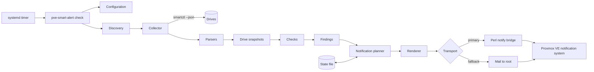

# Architecture

This document describes the current design of PVE SMART Alert: the parts of version 1 and how they fit together.
The reasons are in the decision records under [docs/adr/](docs/adr/README.md), which are linked where they apply. If this document and an accepted record disagree, the record wins.

The design covers the parts that are built and those still to come; which is which, milestone by milestone, is in [ROADMAP.md](ROADMAP.md). For a built part this document describes the code. For a part still to come, names of files, keys and functions are the intended ones and may change until it is built.

## 1. Overview

PVE SMART Alert is a short-lived program started by a systemd timer every 30 minutes on each Proxmox VE node.
One run reads the SMART data of all drives through smartctl, evaluates it against a catalog of checks, compares the result with what it remembered from earlier runs, and sends the notifications that are due into the Proxmox VE notification system.



Properties that follow from this shape:

- The only input from hardware is the output of smartctl. The only output is a call to a transport. Both are replaceable in tests ([ADR 0016](docs/adr/0016-test-strategy.md)).
- Nothing runs between two checks. All memory is in one file ([ADR 0007](docs/adr/0007-state-storage.md)).
- Each node is independent. There is no communication between nodes ([ADR 0007](docs/adr/0007-state-storage.md)).

## 2. Components

| Component | Responsibility | Decision record |
| --- | --- | --- |
| Command-line interface | Parses commands, sets up logging and locking, maps results to exit codes | – |
| Self-diagnosis | Checks the parts of the host the tool works with and reports one line per part (FR-603) | – |
| Configuration | Loads `/etc/pve-smart-alert/config.toml`, validates it, merges it over the built-in defaults, falls back to the last good configuration | [0011](docs/adr/0011-configuration.md) |
| Discovery | Finds drives, enriches them with system information, filters and de-duplicates them | [0005](docs/adr/0005-drive-discovery-and-identity.md) |
| Collector | Runs smartctl for one drive with a timeout and returns JSON, exit status and messages | [0004](docs/adr/0004-smartctl-json-as-data-source.md) |
| Parsers | Translate ATA, SCSI and NVMe JSON into one snapshot model | [0004](docs/adr/0004-smartctl-json-as-data-source.md) |
| Checks | Evaluate a snapshot against thresholds and return findings | [0010](docs/adr/0010-health-evaluation-and-default-thresholds.md) |
| State store | Reads, validates, migrates and atomically replaces the state file | [0007](docs/adr/0007-state-storage.md) |
| Notification planner | Decides from findings and state which notifications are due and which state changes belong to them | [0009](docs/adr/0009-notification-policy.md) |
| Renderer | Produces subject, plain-text body and structured data | [0008](docs/adr/0008-notification-integration.md) |
| Transports | Hand a notification to Proxmox VE: through the Perl bridge or as mail to root | [0008](docs/adr/0008-notification-integration.md) |
| Notify bridge | Perl script that calls `PVE::Notify` | [0008](docs/adr/0008-notification-integration.md) |
| Routing check | Reads the matchers and targets through `pvesh` and evaluates them for the notifications of the tool and for its fallback, mail to root | [0020](docs/adr/0020-routing-check.md), [0022](docs/adr/0022-fallback-routing-check.md) |
| systemd units | Timer, service and failure reporter | [0006](docs/adr/0006-scheduling.md) |
| Fixture tooling | Records and anonymizes smartctl output (`anonymize.py`, `scripts/make_fixtures.py`); fake smartctl for tests | [0016](docs/adr/0016-test-strategy.md), [0023](docs/adr/0023-anonymization-of-recordings.md) |

Dependencies point in one direction: command-line interface → run orchestration → components. Components do not call each other sideways. Discovery, collector, checks, planner and renderer are free of side effects other than running smartctl and reading system files, which makes them testable in isolation.

## 3. Sequence of a run

1. **Lock.** Take the lock in `/run/pve-smart-alert/`. If it is held, exit with a message.
2. **Configuration.** Load and validate. On error, use the last good configuration and record the tool condition `tool.config_invalid`.
3. **State.** Load, migrate if needed. If unreadable, set it aside, start empty and record `tool.state_reset`.
4. **Preflight.** Check that smartctl exists and is version 7.0 or later. If not, record `tool.smartctl_missing` or `tool.smartctl_too_old` and skip to step 9 with no drives.
5. **Discovery.** Run the scan, the probes and the manual entries; enrich, filter, de-duplicate. Result: a list of drives to query and a list of skipped devices with reasons.
6. **Collection and parsing.** For each drive, one after the other: run smartctl with the timeout, parse the output into a snapshot. A drive that fails is recorded as unreadable for this run; a drive in standby is recorded as skipped.
7. **Evaluation.** Run the applicable checks on each snapshot. Result: findings per drive.
8. **Presence.** Compare the drives seen with the drives in state. Update the counters for missing and unreadable drives.
9. **Planning.** From findings, presence, tool conditions and state, compute the notifications that are due, each with the state changes that depend on its delivery, and the state changes that need no notification.
10. **Delivery.** Render and send each notification. For each one that was handed over, apply its state changes.
11. **Save.** Write the state file atomically.
12. **Summary.** Log one line with the counts. Exit 0 if the run completed, non-zero if it could not.

Steps 5 to 8 never abort the run because of a single drive. Steps 9 to 11 are the only ones that change anything outside the process.

With `--dry-run`, steps 10 and 11 are replaced by printing the plan.

The first run is the same sequence with empty state. The planner recognizes it and produces the single first-run summary ([ADR 0009](docs/adr/0009-notification-policy.md)).

## 4. Data model

The models are in `model.py`. The parsers fill the drive snapshot, and the checks read it.

**Drive identity**: model, serial number, WWN if known, normalized: trimmed, inner whitespace collapsed, the WWN as lowercase hexadecimal digits. Key in the state file. An identity is stable only with a serial number or a WWN. See [ADR 0005](docs/adr/0005-drive-discovery-and-identity.md).

**Drive snapshot**: what one run learned about one drive.

| Part | Content |
| --- | --- |
| Identity | Model, serial number, WWN, firmware version, capacity |
| Access | Device name, smartctl type, protocol, aliases |
| Class | `hdd`, `ssd` or `nvme` |
| Location | Controller and device ID, `by-path` and `by-id` links, transport, removable flag |
| Membership | ZFS pool, md array, LVM volume group, if known |
| Capabilities | SMART available, SMART enabled |
| Metrics | A flat mapping from metric name to value, for example `ata.attr.5.raw`, `nvme.available_spare`, `scsi.grown_defects`, `temperature.current`, `wear.percent_used` |
| Flags | Health verdict, NVMe critical warning bits, attributes at or below threshold, last self-test result |
| Context | Power-on hours, power cycles |
| Collection | smartctl version, exit status, messages, duration |

The metric `wear.percent_used` is taken from the first source present, in the order of [ADR 0021](docs/adr/0021-wear-value-source.md): `endurance_used`, then the device statistics, the NVMe health log or the SAS indicator, then the vendor attribute of the web interface's name list, and last the same kind of guess made by smartmontools. For ATA, `endurance_used` counts as the first source only when the device statistics were read; without them smartmontools guesses it from a vendor attribute, and the guess is named as the vendor attribute it is ([Research 03](docs/research/03-smart-indicators.md)). The source is stored next to the value as `wear_source` of the snapshot, and the value the web interface shows as the metric `wear.web_interface_percent_used`: for ATA the vendor attribute, searched exactly as `PVE/Diskmanage.pm` does, for NVMe `percentage_used` ([Research 02](docs/research/02-builtin-smart-handling.md)). `parsers/wear.py` implements it.

**Finding**: check ID, kind (condition or event), severity, current value, threshold that was crossed, short text.

**Notification**: event type (`problem`, `escalated`, `worsened`, `reminder`, `recovered`, `missing`, `summary`, `first-run`, `tool`, `test`), severity, the drives and findings it covers, metadata fields, subject, body, structured data.

Checks read only the snapshot. They never see smartctl JSON. A new data source would only have to produce snapshots.

## 5. Discovery

Sources, in this order ([ADR 0005](docs/adr/0005-drive-discovery-and-identity.md)):

1. `smartctl --scan-open --json`.
2. Probes. Version 1: `cciss,N` for HPE Smart Array, only if an `hpsa` or `smartpqi` host is present. Experimental. Arrives with milestone M6.
3. Manual entries from the configuration, `[[discovery.device]]`. An entry that has the name and type of a device of the scan is not read a second time.

The package `discovery/` implements this since milestone M2. A device found is read once per run, in the order of the scan and then of the manual entries, and every device is reported with its source and what became of it: monitored, in standby, unreadable, or skipped with a reason.

A block device that the scan does not list, such as a USB device with a bridge that smartctl does not know, is not a candidate and does not appear in `scan` as skipped ([Research 07](docs/research/07-standalone-host-pve1.md), Q-S7).

Enrichment reads `lsblk --json` with the columns `NAME,KNAME,TYPE,TRAN,RM,HOTPLUG,FSTYPE,LABEL` once per run, the links below `/dev/disk/by-id` and `/dev/disk/by-path`, and for an NVMe controller its transport in sysfs. It adds transport, removable flag, links and membership; an NVMe controller is described by its namespaces. The volume group comes from the device-mapper names of the LVM devices below a drive, as [Research 06](docs/research/06-test-cluster-recordings.md) verified against `pvs`, which is not called because it reads from the disks. A ZFS pool comes from the label of a `zfs_member` file system, an md array from the name of a `raid` device (Q-S6). Errors here are reported and do not affect the run (FR-110).

Filter rules, each with a reason code shown by `pve-smart-alert scan`:

| Reason | Rule |
| --- | --- |
| `excluded` | Matches an exclude rule ([ADR 0024](docs/adr/0024-drive-selectors.md)) or, from M3 on, a per-drive override with `exclude = true` |
| `remote` | Transport is iSCSI, Fibre Channel or NVMe over Fabrics; the device is not read (Q-S6) |
| `not-a-disk` | Device type is not a disk (enclosure, tape, optical); the device is not read |
| `logical-volume` | Logical volume of a RAID controller or a virtual disk of a hypervisor. Recognized from milestone M6 on, with recordings of such hardware; until then a virtual disk is skipped by an exclude rule such as `{ model = "QEMU HARDDISK" }` |
| `no-smart` | The device reports that it has no SMART capability |
| `duplicate` | Same identity as a device already kept; recorded as an alias. A block device of the host is kept before a pass-through path, the scan before a manual entry. Drives without a stable identity are never merged |

Classification as `excluded`, `logical-volume` and `no-smart` needs the identify data, so it happens after the smartctl call for that device. A device of the scan whose name or type does not have the form that may reach smartctl is reported as unreadable and not read. It is repeated on every run, because a device name can be taken over by a different device. Skipped devices are recorded in state only so that `pve-smart-alert status` can show them.

Controllers whose drives cannot be reached (driver `mpi3mr`) are detected from sysfs and reported as `tool.unsupported_controller`. This arrives with milestone M6.

## 6. Evaluation

- The catalog is a list of check definitions: ID, applicable classes and protocols, the metric or flag it reads, kind, default thresholds, worsening rule, confirmation count, message texts. The list is in [docs/check-catalog.md](docs/check-catalog.md). The package `checks.py` implements it since milestone M3, together with `evaluate`, which turns one snapshot into findings.
- The effective thresholds for a drive are: built-in default, overridden by the global configuration, overridden by the first matching per-drive override. `config.py` resolves them in `effective_checks`.
- A check returns no finding if it is disabled, not applicable to the class, or its input is missing.
- For threshold checks the highest severity whose threshold is met is reported.
- Event checks compare the current counter with the baseline in state and return a finding only when it is above it; without a baseline they return nothing, and the planner records the current value as the baseline (FR-306). `counters` returns the current values of the enabled event checks for that.
- `drive.missing` and `drive.unreadable` are checks of the catalog, so that they can be configured, but no snapshot answers them: the planner raises them from consecutive runs.
- `pve-smart-alert check --dry-run` runs discovery and evaluation and prints the findings per drive; it changes no state and sends nothing. The findings of drives that are missing or unreadable in consecutive runs, and the conditions of the tool itself, arrive with milestone M4 and M5.

## 7. Notification planning

The planner is a pure function: (findings, presence, tool conditions, state, configuration, current time) → (notifications with dependent state changes, independent state changes).

Per condition the state holds: severity, first detection, last notification, value and severity at the last notification, and counters for confirmation and clearing.
The rules are those of [ADR 0009](docs/adr/0009-notification-policy.md). In short:

| Trigger | Result |
| --- | --- |
| New condition, confirmed | `problem` |
| Higher severity | `escalated`, immediately |
| Worse value, same severity, cool-down passed | `worsened` |
| Reminder interval passed | `reminder` |
| Absent for the clear count | `recovered` |
| Event counter above baseline, cool-down passed | `problem` for the event; baseline moves |
| Drive absent for 2 runs | `missing`, once |
| Tool condition | Same rules, pseudo-device `pve-smart-alert` |

Grouping: one notification per drive per run. More drives than the grouping limit: one `summary`. First run: one `first-run`.

Time is passed in, never read from the system clock inside the planner. This is what makes every rule testable.

`planner.py` implements it since milestone M4. Its input is the state, an `Observation` of the run (each device as read, in standby or unreadable, with its findings and the current values of its event counters; the skipped devices; the tool conditions that hold now; whether the state was reset; whether the device scan worked), the configuration and the time. Its output is a `Plan`: the state with every change that needs no notification, and the notifications that are due, each with the changes that are applied only after it was handed over. How the rules are read where ADR 0009 leaves room:

- A condition that is active but was never notified, because its notification failed, is planned as `problem` again. A condition that clears before it was ever notified goes silently.
- A falling severity lowers the notified severity and value, so that a later rise is an `escalated` and the reminder follows the lower severity.
- `worsened` applies to the checks whose worsening is *increase* in [docs/check-catalog.md](docs/check-catalog.md), and waits for the cool-down since the last notification about the drive, whatever that notification was.
- An event counter without a baseline starts at its value; one below its baseline lowers it; one above it is notified after the event cool-down of the drive and check, and only then does the baseline move.
- A device that answers without usable data is matched to the drive last read through the same name and type. A device that never answered with an identity gets a record of its own, keyed by name and type, that only holds `drive.unreadable`. While a drive is missing, unreadable or in standby, its other conditions are frozen.
- When the device scan failed, drives that were not found were not looked for, and their absence is not counted.
- A drive that is skipped as `excluded` or `no-smart` is no longer monitored, and its record is removed without a message. A condition of a check that was switched off is removed without a recovery.
- The first run records every condition as notified and every counter as a baseline. Without the summary handed over, nothing of it is stored, and the next run is a first run again.

## 8. Configuration

File: `/etc/pve-smart-alert/config.toml` ([ADR 0011](docs/adr/0011-configuration.md)). Everything is optional. Example with typical overrides:

```toml
[smartctl]
# path = "/usr/sbin/smartctl"
timeout = "30s"
detail = "extended"          # "extended" (--xall) or "basic" (--all)

[discovery]
probe_cciss = true           # experimental probing for HPE Smart Array
exclude = [
    { model = "QEMU HARDDISK" },
    { serial = "WD-WX11A1234567" },
]

# A controller that the scan does not cover
[[discovery.device]]
name = "/dev/sg3"
type = "areca,2"

[notify]
transport = "auto"           # "auto", "pve-notify" or "mail"
max_drive_notifications = 3
recovery = true
first_run_summary = true
worsening_cooldown = "6h"
event_cooldown = "24h"
clear_runs = 2
missing_runs = 2
unreadable_runs = 2

[notify.reminder]
critical = "3d"
warning = "7d"
notice = "never"

# Global override of one check
[checks."temperature"]
warning = { hdd = 48, ssd = 60, nvme = 72 }
confirm_runs = 3

[checks."ata.crc_errors"]
enabled = false

# Override for one drive
[[drive]]
serial = "S4EWNX0M123456A"
comment = "Worn, replacement ordered"

[drive.checks."wear"]
enabled = false

[drive.checks."nvme.reliability_degraded"]
enabled = false
```

Validation is strict: an unknown key is an error. An invalid file never stops monitoring; the last good configuration is used and the problem is reported.

The loader of `config.py` accepts these keys since milestone M3: `transport` in `[notify]`, and since milestone M4 the settings of the notification policy in `[notify]` and `[notify.reminder]` (FR-404), with the defaults of [ADR 0009](docs/adr/0009-notification-policy.md): a reminder is a duration from `"1h"` to `"365d"` or `"never"`, a cool-down a duration from `"0s"` to `"365d"`, a count of runs a whole number from 1 to 100, and `max_drive_notifications` one from 1 to 1000; `path`, `timeout` (from `"1s"` to `"15m"`) and `detail` in `[smartctl]`; the manual devices of `[[discovery.device]]`, whose name must lie below `/dev` and whose type must have the form of a smartctl device type; the exclude rules of `[discovery]` with exactly one selector each ([ADR 0024](docs/adr/0024-drive-selectors.md)); the global overrides of `[checks."<check-id>"]`, which accept `enabled`, the thresholds `notice`, `warning` and `critical` that the check has, one number or, for the one check that differs per class, a table of the classes, and for a check of the kind condition its confirmation count `confirm_runs` (1, and 2 for the temperature, FR-308); and the per-drive overrides of `[[drive]]`, each with exactly one selector, an optional `comment`, `exclude`, `detail` and the same check overrides in a table `checks` (FR-403). Every other key in the example above is rejected as unknown until the milestone that implements it.

After every successful validation the effective configuration is saved as `last-good-config.json` in the state directory (ADR 0011). A file that does not validate at run time leads to the last good one, or to the built-in defaults when there is none, together with a tool-level warning (FR-406); `pve-smart-alert doctor` reports the situation as a warning, and `pve-smart-alert config check` and `config show` answer from the same mechanism. An override that repeats the built-in default is dropped when the file is loaded, so that the reference, which lists every key with its default, changes nothing.

## 9. State

File: `/var/lib/pve-smart-alert/state.json` ([ADR 0007](docs/adr/0007-state-storage.md)), written by `state.py` since milestone M4. Shape:

```json
{
  "schema": 1,
  "host": "pve1",
  "initialized": "2026-10-03T12:04:11Z",
  "last_run": {
    "started": "2026-10-03T14:34:10Z",
    "finished": "2026-10-03T14:34:13Z",
    "result": "ok",
    "drives_evaluated": 6,
    "drives_skipped": 1,
    "drives_failed": 0,
    "notifications_sent": 1,
    "notifications_failed": 0
  },
  "drives": {
    "Samsung SSD 870 EVO 1TB|S5Y1NX0R000001A": {
      "identity": {
        "model": "Samsung SSD 870 EVO 1TB",
        "serial": "S5Y1NX0R000001A",
        "wwn": "5002538f00000001"
      },
      "class": "ssd",
      "last_access": { "name": "/dev/sdb", "type": "sat" },
      "first_seen": "2026-10-03T12:04:11Z",
      "last_seen": "2026-10-03T14:34:11Z",
      "missing_runs": 0,
      "unreadable_runs": 0,
      "missing_notified": false,
      "exempt_from_missing": false,
      "last_notified": "2026-10-03T12:34:13Z",
      "baselines": { "ata.crc_errors": 12, "ata.error_log": 0 },
      "event_notified": {},
      "conditions": {
        "ata.reallocated_sectors": {
          "severity": "warning",
          "first_detected": "2026-10-03T12:34:12Z",
          "current_value": 8,
          "threshold": 5,
          "text": "8 sectors, at or above the warning threshold of 5",
          "last_notified": "2026-10-03T12:34:13Z",
          "notified_severity": "warning",
          "notified_value": 8,
          "clear_runs": 0
        }
      },
      "pending": {},
      "details": {
        "firmware": "SVT02B6Q",
        "capacity_bytes": 1000204886016,
        "location": "pci-0000:00:17.0-ata-2",
        "used_by": "ZFS pool \"tank\"",
        "transport": "sata",
        "removable": false
      }
    }
  },
  "skipped": {
    "/dev/sda|scsi": { "reason": "logical-volume", "since": "2026-10-03T12:04:11Z" }
  },
  "tool": { "conditions": {}, "last_notified": null }
}
```

- The key of a drive is model and serial number, model and `wwn:` with the WWN when there is no serial number, and for a drive without either the model with `device:` and the path it was read through, because two such drives may be two drives ([ADR 0005](docs/adr/0005-drive-discovery-and-identity.md)). A device that never answered with an identity is kept as `device:<name>|<type>` with `identity` set to `null`, and only ever holds the condition `drive.unreadable`.
- `initialized` is `null` until a first run has been completed; a state without it is a first run.
- A condition with `last_notified` set to `null` is active but was not notified yet, because its notification was not handed over; the next run plans it again. `pending` holds conditions that were seen but still wait for their confirmation count. `last_notified` of the drive is the time of the last notification about it, for the worsening cool-down; `event_notified` holds the same per event check, for the event cool-down.
- `details` keeps what a notification about the drive shows while it cannot be read, for example when it is missing.
- Atomic replacement: the file is written to a temporary file in the same directory with mode 0600, flushed to disk, renamed over the old file, and the directory is flushed.
- A file that does not parse or validate, and one with a newer schema version than the program reads, is renamed to `state.json.corrupt-<timestamp>`; the run continues with empty state. A timestamp that lies in the future is read as the current time. Each schema version gets a migration function to the next one; version 1 is the first.

## 10. Notification integration

### Bridge contract

The Python side starts `/usr/libexec/pve-smart-alert/notify-bridge` and writes one JSON document to its standard input:

```json
{
  "severity": "warning",
  "template": "pve-smart-alert",
  "fields": {
    "type": "pve-smart-alert",
    "hostname": "pve1",
    "event": "problem",
    "device": "/dev/sdb",
    "serial": "S5Y1NX0R000001A",
    "model": "Samsung SSD 870 EVO 1TB"
  },
  "data": {
    "subject": "...",
    "body": "...",
    "drives": [],
    "findings": []
  }
}
```

The bridge loads `PVE::Notify`, checks that the expected function exists, adds the common template data if available, and calls `PVE::Notify::notify($severity, $template, $data, $fields)`.
It answers on standard output with `{"ok": true}` or `{"ok": false, "error": "..."}` and exits with 0 or non-zero accordingly. What the notification library logs to standard error is passed through and captured by the Python side.
With the single argument `--check`, the bridge only loads the module and looks for the function, reads no request and sends nothing; `pve-smart-alert doctor` runs it this way.

Checked on Proxmox VE 9.2 (2026-10-04, [Research 01](docs/research/01-notification-integration.md#route-b-pvenotify)): the call works from a separate root process with these four arguments and no configuration argument. The library writes one line per target to standard error and to the journal, as `` notified via target `NAME` `` or `` could not notify via target `NAME`: REASON ``. A missing template makes the call return success and logs `failed to render notification template, all template candidates are erroneous or missing`, which the Python side turns into the mail fallback. When no matcher matches, the call returns success and logs nothing.

### Routing check

`routing.py` ([ADR 0020](docs/adr/0020-routing-check.md)) runs `pvesh get /cluster/notifications/matchers --output-format json` and the same for the targets, each with a timeout of 30 seconds, and evaluates the answers for each severity of the tool (`info`, `notice`, `warning`, `error`).

- A matcher in the answer has `name`, `mode`, `target`, `match-field`, `match-severity` and `origin`, and optionally `comment` and `disable: 1`, as observed on Proxmox VE 9.2 ([Research 06](docs/research/06-test-cluster-recordings.md)).
- The evaluation follows `proxmox-notify` ([Research 01](docs/research/01-notification-integration.md)): the mode combines the rules of each kind and then the kinds, a matcher without rules matches everything, `invert-match` inverts the result of the others, and a disabled matcher and a disabled or missing target take no part.
- The matchers see the fields `type` and `hostname` of every notification of the tool. A rule on `event`, `device`, `serial` or `model` depends on the notification. A rule on any other field does not match, because the tool does not send it.
- Undecided, and never counted as routed: a rule that depends on the notification, a `match-calendar` rule, an unknown key or mode, a value that is not understood, and a regular expression that Python cannot compile or compiles only with a warning. The results are combined in three-valued logic, so that a decided result never rests on an undecided part.
- The fallback, mail to root, is evaluated as the notification the mail forwarder makes of it: the type `system-mail`, the field `hostname`, the severity `unknown` ([ADR 0022](docs/adr/0022-fallback-routing-check.md)). It reaches the forwarder only if `/root/.forward` has a line that pipes mail to `proxmox-mail-forward`; the file is read, never changed, and aliases of the mail system are not read.
- A matcher whose rules match but that is disabled, or whose targets are all disabled or missing, is named in the advice with what it would route.

`pve-smart-alert doctor` reports two lines. The matchers and targets are read once for both.

| Line | Status | When |
| --- | --- | --- |
| `routing` | `ok` | Every severity reaches an enabled target. The line names the matchers |
| `routing` | `warn` | A severity reaches no target. The line names it; the advice names a matcher that would route it if it or its target were enabled, or says how to add one. Severities that cannot be decided are named as well |
| `routing` | `skip` | The matchers cannot be read (no `pvesh`, an error, a timeout), or the routing cannot be decided (the reasons follow) |
| `fallback` | `ok` | Mail to root reaches an enabled target. The line names the matchers |
| `fallback` | `warn` | No matcher routes `system-mail` to an enabled target, or `/root/.forward` does not pipe mail to the forwarder |
| `fallback` | `skip` | The matchers or `/root/.forward` cannot be read, the routing cannot be decided, or the transport has no fallback (`pve-notify`, `mail`) |

With `transport = mail` every notification goes as mail to root, so the line `routing` reports that route, prefixed with `transport = mail:`.

`pve-smart-alert test-notification` evaluates the delivered test notification with its exact fields and prints the matchers that route it, or says that none does and names a matcher that matches but routes nowhere. A test that went as mail is evaluated as `system-mail`. The remark that an empty log can mean that no matcher matched appears only when the notify route was used and the line `Matchers` could not decide; the mail route never returns a log of the notification system.

Checked on Proxmox VE 9.2 (2026-10-07, node `pve7`, acceptance step 5 of M2): with the matcher of the tool routing all four severities, `doctor` reports `routing` as `ok`, by `pve-smart-alert`, and `test-notification --severity info` is delivered and names `pve-smart-alert`. With the matcher limited to `warning,error`, `doctor` reports `warn` and names `info` and `notice`. With the matcher disabled, `doctor` names all four severities, `test-notification` says that no matcher routes the test, and the library logs `skipping disabled matcher 'pve-smart-alert'` instead of nothing.

Checked on Proxmox VE 9.2 (2026-10-07, node `pve7`, [ADR 0022](docs/adr/0022-fallback-routing-check.md)): in the configuration of the cluster, `doctor` reports `routing` as `ok`, by `pve-smart-alert`, and `fallback` as `ok`, mail to root routed as `system-mail` by `default-matcher`. `test-notification --transport mail` is delivered as mail, names `default-matcher, as system-mail`, and the mail arrives. With the matcher of the tool disabled, `routing` warns and the advice names `pve-smart-alert` as the matcher that matches all four severities but is disabled. With the default matcher limited to `exact:type=vzdump`, `fallback` warns that no matcher routes the type `system-mail` to an enabled target.

### Templates

Installed in `/usr/share/pve-manager/templates/default/`:

- `pve-smart-alert-subject.txt.hbs`: `{{subject}}`
- `pve-smart-alert-body.txt.hbs`: `{{body}}`

Administrators can override them in `/etc/pve/notification-templates/default/` and use the structured fields under `drives` and `findings`.

### Mail transport

A plain-text message to `root` through `/usr/sbin/sendmail`. The subject starts with `[pve-smart-alert] <SEVERITY>`. Proxmox VE forwards it into the notification system as `system-mail` with severity `unknown`.

### Example message

Subject:

```text
[pve-smart-alert] WARNING pve1: /dev/sdb Samsung SSD 870 EVO 1TB (S5Y1NX0R000001A): 8 reallocated sectors
```

Body:

```text
A drive in pve1 needs attention.

Host:       pve1 (cluster: lab)
Drive:      /dev/sdb [sat]
Model:      Samsung SSD 870 EVO 1TB
Serial:     S5Y1NX0R000001A
WWN:        5002538f00000001
Firmware:   SVT02B6Q
Capacity:   1.00 TB, SSD
Location:   pci-0000:00:17.0-ata-2
Used by:    ZFS pool "tank"
Powered on: 14210 hours

Findings:
  WARNING  ata.reallocated_sectors
           Reallocated sectors: 8 (previous: 0)
           Thresholds: notice 1, warning 5, critical 70

What to do:
  Plan a replacement. Reallocated sectors that keep increasing indicate a failing drive.

This is the first notification for this problem. Without a change, the next
reminder follows in 7 days. To adjust or silence this check for this drive,
see /etc/pve-smart-alert/config.toml.

pve-smart-alert 1.0.0 on pve1
```

## 11. Error handling

| Situation | Behavior |
| --- | --- |
| smartctl is missing or not executable | No drive is evaluated. Tool condition `tool.smartctl_missing`, critical. Run exits 0 after reporting |
| smartctl is older than 7.0 | Same, `tool.smartctl_too_old` |
| Device scan fails or returns invalid JSON | Manual entries and drives known from state are still tried. `tool.scan_failed`, warning |
| A drive cannot be opened or returns no identify data | Counted as unreadable for this run. After 2 runs: condition `drive.unreadable` |
| smartctl exceeds the timeout | Process group is killed. Treated as unreadable. The run continues with the next drive |
| smartctl returns invalid or truncated JSON | Treated as unreadable. Output is logged at debug level |
| SATA drive is in standby | Skipped for this run. Previous state is kept. No finding |
| A JSON section is missing | The checks that need it are not applicable |
| Drive reports SMART as disabled | Notice `smart.disabled`. Nothing is changed on the drive |
| Device has no SMART capability | Skipped with reason `no-smart`. No finding |
| A known drive is absent | Counter increases. After 2 runs: `drive.missing`, once. Not for removable drives |
| Controller cannot be queried by smartctl | `tool.unsupported_controller`, notice |
| Configuration file is invalid | Last good configuration is used. `tool.config_invalid`, warning |
| State file is unreadable or has an unknown schema | File is renamed, empty state is used, `tool.state_reset`. Next notification is one summary |
| State directory is not writable | Run fails after delivering what it can. The failure unit reports it |
| Another run holds the lock | Exit with a message and a distinct exit code. Not an error for the timer |
| pmxcfs is not available | The bridge fails. The mail fallback is used |
| Notify bridge fails, is missing, or times out | Mail fallback in the same run. `tool.transport_degraded`, warning |
| Template cannot be rendered by Proxmox VE | Detected from the library's log output. Treated like a bridge failure |
| All matched targets fail | The notification counts as not delivered and is planned again in the next run |
| No matcher matches | Nothing is sent, and the call succeeds with an empty log. Not an error of the run. `pve-smart-alert doctor` reports the severity as not routed, and `pve-smart-alert test-notification` says that no matcher routes the test ([ADR 0020](docs/adr/0020-routing-check.md)) |
| No matcher routes mail to root | The fallback is dropped as well. `pve-smart-alert doctor` reports the line `fallback` as `warn` ([ADR 0022](docs/adr/0022-fallback-routing-check.md)) |
| Mail command fails as well | The notification is not delivered. State is not advanced. The run exits non-zero and the failure unit tries a minimal mail |
| Unhandled error in the program | The service fails. `pve-smart-alert-failure.service` sends a short mail to root, at most once per day |
| System clock jumps | Timestamps in the future are treated as "now" |

Principle: a problem with one drive is a finding about that drive; a problem with the tool is a tool condition; only a problem that prevents the run from finishing is a failed run.

## 12. Files on the host

| Path | Owner | Content |
| --- | --- | --- |
| `/usr/sbin/pve-smart-alert` | package | Launcher |
| `/usr/share/pve-smart-alert/pve_smart_alert/` | package | Python code |
| `/usr/libexec/pve-smart-alert/notify-bridge` | package | Perl bridge |
| `/usr/libexec/pve-smart-alert/report-failure` | package | Shell script for the failure unit |
| `/usr/share/pve-manager/templates/default/pve-smart-alert-*.hbs` | package | Notification templates |
| `/usr/lib/systemd/system/pve-smart-alert.{service,timer}`, `pve-smart-alert-failure.service` | package | Units |
| `/usr/share/doc/pve-smart-alert/` | package | Reference configuration, changelog, license |
| `/usr/share/man/man8/pve-smart-alert.8.gz` | package | Manual page |
| `/etc/pve-smart-alert/config.toml` | package, editable | Configuration |
| `/var/lib/pve-smart-alert/state.json` | run time | State |
| `/var/lib/pve-smart-alert/last-good-config.json` | run time | Last valid configuration |
| `/run/pve-smart-alert/` | run time | Lock, stamp file of the failure unit |

Nothing else is created or changed ([ADR 0012](docs/adr/0012-read-only-and-coexistence-with-smartd.md), [ADR 0013](docs/adr/0013-packaging-and-installation.md)).

## 13. systemd units

Sketch of the intended units ([ADR 0006](docs/adr/0006-scheduling.md)):

```ini
# pve-smart-alert.timer
[Timer]
OnBootSec=3min
OnUnitActiveSec=30min
AccuracySec=1min

[Install]
WantedBy=timers.target
```

```ini
# pve-smart-alert.service
[Unit]
Description=PVE SMART Alert drive health check
After=pve-cluster.service
OnFailure=pve-smart-alert-failure.service

[Service]
Type=oneshot
ExecStart=/usr/sbin/pve-smart-alert check
RuntimeDirectory=pve-smart-alert
RuntimeDirectoryPreserve=yes
StateDirectory=pve-smart-alert
StateDirectoryMode=0700
TimeoutStartSec=15min
Nice=10
IOSchedulingClass=best-effort
IOSchedulingPriority=7
```

Sandboxing options of systemd are applied only where they are known not to interfere with mail submission or with the notification targets, which run inside the bridge process. Which options are safe is an open question to be settled in the packaging milestone.

## 14. Security

- The tool runs as root, because smartctl needs raw device access and the notification configuration is readable by root only.
- It accepts no input from the network and opens no socket. Network traffic to SMTP, Gotify or webhook targets is made by the Proxmox VE notification library inside the bridge process, according to the administrator's notification configuration.
- External programs (smartctl, lsblk, pvesh, the bridge, sendmail) are started with argument lists, never through a shell. Device names and types are checked against strict patterns.
- The content of smartctl output is treated as untrusted data: it is parsed as JSON, and strings from drives (model, serial number, firmware) are length-limited and stripped of control characters before they are used in messages or as metadata values.
- The state file is readable by root only. The configuration file is writable by root only.
- `dump-fixture` replaces serial numbers, WWNs and other identifying values before anything leaves the host.

## 15. Extension points

| Extension | Where it attaches |
| --- | --- |
| New check | One definition in the catalog plus a fixture |
| New controller family | A discovery probe; parsers and checks are unaffected |
| New data source | Anything that produces snapshots |
| New transport, for example for Proxmox Backup Server | The transport interface |
| HTML notifications | An additional template file and renderer output |
| Cluster-wide or drop-in configuration | Additional layers in the configuration loader |
| History and rate-based checks | A separate store next to the state file, with its own decision record |

## 16. Not yet settled

Points that affect this design and are still open are collected in [OPEN-QUESTIONS.md](OPEN-QUESTIONS.md). The most important ones are the exact JSON that smartctl produces for standby and for devices behind MegaRAID, and the probing rules for HPE controllers.
